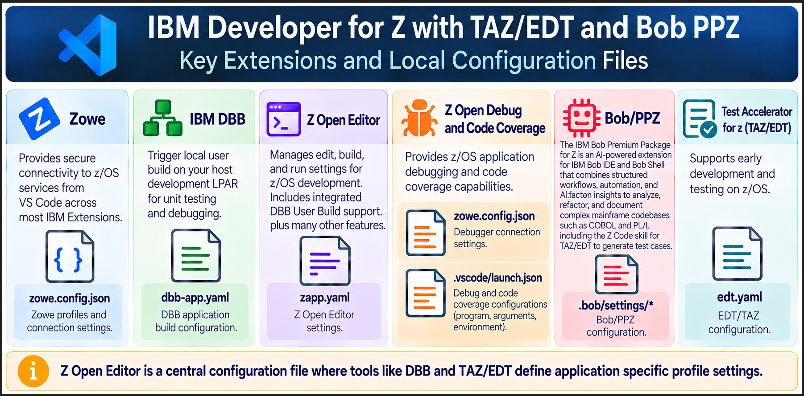
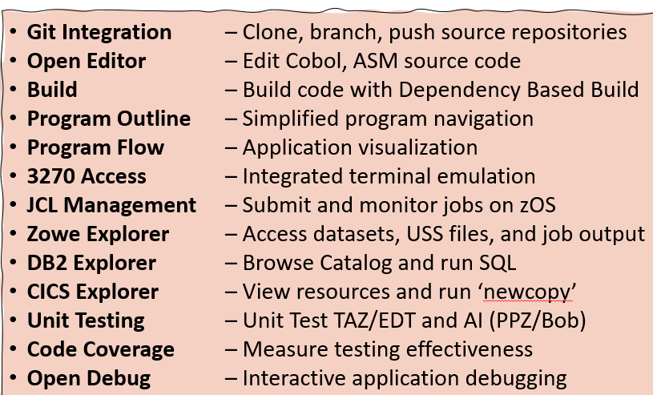
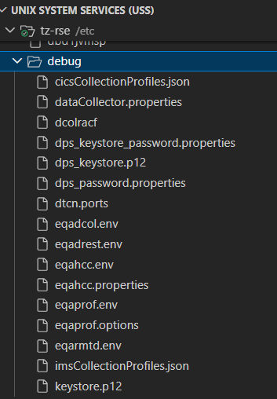

# IBM Z Developer for Z (IDZ): Configuration Management Best Practices 
**IBM zLabConnect | Administration Best Practices | October 2026: Draft 1 in final review (external) 
** Authored: Nelson Lopez, Dina Al Jibori, Nicholas Almy  (IBM Forward Deploy Engineers)**

VS Code and IBM Bob provide a flexible development environment through IBM Z extensions (IDZ v17.0.x) and integrated client-side and host-side configurations. Managing these configurations consistently across the enterprise is essential to simplifying deployment, maintenance, upgrades, and operational support.

This document defines administrator roles, responsibilities, and best practices for enterprise z/OS environments. It guides administrators in standardizing, managing, and distributing approved configurations across developer workstations, shared infrastructure, and z/OS host environments to support consistent, secure, and reliable development workflows throughout the application lifecycle.

**IBM's Configuration Strategy:** IBM Z development tools are designed to support a layered, flexible architecture that enables organizations to deliver consistent development experiences, simplify administration, and scale to meet evolving business and operational needs.




## Quick Reference: Z Developer Extension and Configuration Files (Short list)

| **Extension / Component** | **Configuration File or Resource** | **Capability**|
| --- | --- | --- |
| IBM DBB v3| `dbb-app.yaml` | DBB application build configuration.  |
| DBB schema validation | DBB JSON schema files      | Validation and editing assistance for DBB YAML configuration. |
| Git integration   | `.gitattributes`   | Git repository configuration encoding rules.  |
| IBM Z Open Debug  | `.vscode/launch.json`      | list parked applications for debugging.|
|   | `zowe-config.json` | has the zOpenDebug profile used for debugging and TAZ EDT.    |
| IBM Z Open Editor | `zapp.yaml`| Language-aware source editing and application configuration.  |
|   | `user settings.json`| for personal user setting like MVS HLQ and USS working directory      |
| IBM TAZ/EDT| `zapp.yaml`| `Test` profile for TAZ unit testing.  |
|   | `workspace or user settings`| EDT specific workspace or user settings.      |
| Zowe Explorer     | `zowe-config.json` | Secure access to z/OS resources - data sets, USS files, jobs, and supported services. |

**Note:** A configuration filename does not necessarily belong exclusively to one extension. Some files configure VS Code itself, while others are interpreted by a specific IBM tool. Always verify the supported file location, format, and scope for the installed version.


### IDz Feature Summary 

Collectively, the IBM Developer for z/OS suite provides a comprehensive set of capabilities that help developers quickly understand existing applications, implement changes, and accelerate development.



---


## Administration Roles and Responsibilities

IBM Developer for z/OS (IDz) relies on coordinated administration across developer workstations, distributed infrastructure, enterprise DevOps services, and z/OS host environments. Each administrator manages a specific area of the platform and collaborates with other teams to provide a consistent, secure, and reliable development environment.


| Role                                   | Primary Responsibilities                                                                                                                                   |
| -------------------------------------- | ---------------------------------------------------------------------------------------------------------------------------------------------------------- |
| **Enterprise / DevOps Administrator**  | Manages source control, work management, code quality, artifact repositories, SaaS services, AI services, and pipeline integrations.                       |
| **Desktop Administrator**              | Installs and maintains VS Code, IBM Z extensions, approved developer tools, workstation settings, and access policies.                                     |
| **IDz / z/OS Dev Tools Administrator** | Configures IBM Developer for z/OS, host development services, connectivity, and integrations for editing, building, testing, debugging, and code coverage. |
| **System Administrator**               | Manages z/OS subsystems and services, including CICS, Db2, RACF, networking, and related operational requirements.                                         |
| **z/OS System Programmer**             | Installs and maintains IBM and third-party software using SMP/E, applies PTFs, and manages system libraries, configuration, and LPARs.                     |
 


### Collaboration Across Administrators and Developers

Effective collaboration between administrators and developers is essential to maintaining a consistent, secure, and reliable z/OS development environment. 

Administrators with elevated privileges collaborate with developers to install, configure, validate, and maintain the development platform and its supporting services. Clearly defined responsibilities, standardized configurations, documented procedures, and coordinated change management promote consistent environments, simplify onboarding and troubleshooting, and ensure reliable platform operations in support of the software development lifecycle (SDLC).

This collaboration spans five key areas:

1. **Install** — System programmers acquire and install supported software and PTFs. Infrastructure and desktop administrators provision the required environments and developer tools.

2. **Configure** — DevOps administrators configure repositories, pipelines, and integrations. IDz and z/OS Dev Tools administrators configure developer tools, host services, connectivity, and development workflows. System administrators provide the necessary subsystem and security configurations.

3. **Validate** — Administrators and developers verify workstation setup, authentication, network connectivity, source access, builds, testing, debugging, code coverage, and deployment workflows.

4. **Support and maintain** — Administrators coordinate troubleshooting, manage software updates and configuration changes, monitor shared services, and resolve issues across workstation, distributed, and z/OS environments.

5. **Enable continuous improvement** — Developer feedback, operational experience, and pipeline results drive configuration updates, tool upgrades, process improvements, and standardized development practices.

### Objective

The goal is to establish a **standardized, secure, and well-managed IBM Developer for z/OS environment** that reduces onboarding effort, simplifies maintenance and troubleshooting, and enables development teams to use consistent workflows from source changes through build, test, and deployment.

---

## Desktop and z/OS Configuration Overview

On the desktop, VS Code and IBM Z extensions use configuration files in a hierarchical structure to define personal preferences, application settings, and organization-wide standards. Administrators should understand the purpose of each level and use it to establish consistent, maintainable development environments.

| **Level**   | **Purpose** |**Example** |
| --- | --- | --- |
| **Shared Configuration** | Centrally store and distribute approved configuration files for team use.     | Shared DBB schema files or Zowe CLI configuration|
| **Workspace Settings**   | `./.vscode/settings.json` - Define settings specific to an application or project and share them through source control.  | Project-specific build settings and extension.  Note: For applications that include source from 2 or more repos,  a **Multi-root** workspaces would be designed to manged cross repo local builds.   
| **User Settings**| `%USERPROFILE%/.../settings.json` - Define personal settings that apply across a developer's workspaces.  | Editor preferences and personal options  |
| **z/OS Host Configuration**  | __Non-VS Code settings__ - Configure host endpoints, connections, services, and resources required by development tools. | Z system administrators and desktop administrators collaborate to design a consistent, secure, and reliable environment. For example, certain TAZ/EDT variables can be defined globally in central `/etc/profile`. | 


**Best practice:**
- Use shared configuration for centrally maintained standards, workspace default settings for application-specific requirements, and user settings for individual preferences.
- Manage host-side configuration separately, according to each product’s requirements.
- Maintain centrally shared and workspace configuration files as reference templates to standardize and simplify organizational rollout.
- Use comments to explain configuration settings, document organizational standards, and identify values that require customization. YAML supports `#` comments, while VS Code `settings.json` supports `//` and `/* ... */` comments.

Example Comments — VS Code `settings.json`:

  ```
  {
      // Use the approved z/OS development profile.
      "zopeneditor.zowe": {
          "defaultProfile": "ZOSDEV"
      }
  }
  ```

Example — YAML:

  ```
  # DBB build environment configuration
  # Use the approved data set HLQ.
  dbb:
    hlq: IBMUSER.VSCODE
  ```


**Client configuration precedence:** Workspace settings generally override User settings, while administrator policies may override both. Shared configuration files and z/OS host settings follow product-specific rules.

**References:** [VS Code — User and Workspace Settings](https://code.visualstudio.com/docs/configure/settings) · [VS Code — Enterprise Policies](https://code.visualstudio.com/docs/enterprise/policies)


### Example: Zowe Configuration
A Zowe configuration contains many profiles that define specific connection settings for z/OS host services. 

For example, an [IBM Z Open Debug](https://www.ibm.com/docs/en/developer-for-zos/17.0.x?utm_source=chatgpt.com) profile defines the Remote Debug Service (RDS/EQARMTD) and Debug Profile Service (DPS/EQAPROF) endpoints for a specific LPAR. Depending on the configuration, connectivity may also rely on approved security controls, such as TLS certificates and MFA, and supporting z/OS services and APIs, such as RSE API and z/OSMF.

Host services may also communicate with other host components to fulfill client requests. These interactions require appropriate host-side configuration, including network connectivity, port definitions, and security settings. For example, z/OS administrators configure the required connectivity and security to allow the debugger to access the Headless Code Coverage service (EQAHCC).

---

## Which Configurations Can Be Centrally Managed?

In IBM Z development environment (V17.0.x), the following configurations are recommended for centralized management where supported:

- **Zowe configuration (`zowe.config.json`)** — Defines z/OS connection profiles and related settings  (see below)

- **DBB v3 zBuilder schema configuration** — Defines the schema information used by DBB tooling.\
  Reference: Schema [https://www.ibm.com/docs/en/adffz/dbb/3.0.x?topic=ide-configuring-schema-validation-vs-code](https://www.ibm.com/docs/en/adffz/dbb/3.0.x?topic=ide-configuring-schema-validation-vs-code)\
  Example *workspace* setting referencing a shared DBB schema configuration file:
  ```
      {
        "yaml.schemas": {
            "file://server/share/dbb/applicationConfigurationSchema.json": [ ... ],
            "file://server/share/dbb/buildConfigurationSchema.json": [ ... ]
        }
      }
  ```


## Workspace Settings (Application or Team Settings)

A VS Code workspace configuration allows a team to share project-specific settings to support a consistent development environment.

An administrator can provide a standard workspace configuration template when the initial main application branch is established. The team lead or senior developer can then customize it for the application and commit it to the repository for the team to use and maintain throughout the application's lifecycle.

An administrator should plan, design, and verify the required settings across the entire development product stack, including VS Code, IBM extensions, build tools, testing tools, debugging tools, agent plugins and host connectivity. 

The goal is to ensure that the components work together as a complete development environment. Once validated, the administrator should export or document the approved settings as a reference configuration for the rollout. This helps team leads and developers understand which settings to apply, which files to maintain in the application repository, and which prerequisites must be configured locally or on z/OS. It also provides a baseline for troubleshooting and future configuration changes.


| **Component** | **Configuration File** | **Purpose**  |
| --- | --- | --- |
| VS Code   | `./.vscode/settings.json` | Stores workspace-specific editor and extension settings. |
| *IBM Z Open Editor | `zapp.yaml`| Defines supported language and application configurations used by the editor and other IBM extensions.   |
| *IBM DBB v3| `dbb-app.yaml`| Defines application DBB User Build configuration.|
| *IBM Z Open Debug  | `./.vscode/.launch.json`  | Defines debug launch configurations to list parked debug sessions.|
| IBM TAZ EDT| `./.vscode/settings.json` | Defines EDT specific settings (See TAZ below)    |
| Git| `./.gitattributes`| Defines file-specific Git attributes, such as line-ending and host encoding rules|

> Items marked with '*' require an associated Zowe profile. 


References:
- [Z Open Editor workspaces](https://ibm.github.io/zopeneditor-about/Docs/zapp.html#single-root-versus-multi-root-workspaces)
- [Z Open Editor zapp.yaml](https://ibm.github.io/zopeneditor-about/Docs/zapp.html#zapp-use-cases)
- [DBB zBuilder dbb-app.yaml](https://www.ibm.com/docs/en/adffz/dbb/3.0.x?topic=concepts-application-configuration)
- [IBM Z Open Debug](https://www.ibm.com/docs/en/developer-for-zos/17.0.x?topic=code-setting-up-z-open-debug)
- [TAZ EDT - Getting Started](https://www.ibm.com/docs/en/test-accelerator-for-z/3.x?topic=SSLGKGY_3.x/topics/early_development_testing_fresh.htm)
- [Bob IDE](https://bob.ibm.com/docs/ide/premium-packages/bob-for-z/bob-for-z-index)
- [IBM Bob Premium Package for Z](https://www.ibm.com/docs/en/bobz/3.x?topic=overview-discover-whats-inside-bob-premium-package-z)

---

## Zowe Profiles and z/OS Connectivity

Zowe provides connection configuration used by Zowe Explorer and several other IBM extensions to securely access z/OS services.
Reference: [Interacting with z/OS using Zowe](https://www.ibm.com/docs/en/developer-for-zos/17.0.x?topic=code-interacting-zos-using-zowe)

A Zowe profile can define information such as:

- The z/OS Hostname and port endpoint.
- Authentication method and user identity.
- Service-specific connection options.
- And other extension specif settings.

Depending on the tool and its configuration, profiles provide secure access to z/OS resources, such as browsing and editing data sets, accessing USS files, and submitting jobs and viewing their output. They also enable connectivity to a wide range of z/OS services, including DBB, TAZ/EDT, the Debugger, and more.


### Shared Zowe profiles

Instead of maintaining a separate copy for every developer, an organization can place the file in the application workspace/repo as a [team configuration file](https://docs.zowe.org/v3.5.x/user-guide/cli-using-using-team-profiles/?utm_source=chatgpt.com).

Alternatively, administrators can centrally manage the Zowe configuration file and push updated copies to each user's workstation during login.

The local `ZOWE_CLI_HOME` environment variable points Zowe to the shared readonly configuration directory. This approach keeps configuration consistent while allowing each user to maintain their own local logs and credential store.

Verify that the installed Zowe CLI and dependent extensions support this arrangement.
Reference: [Configuring Zowe CLI environment variables](https://docs.zowe.org/v3.2.x/user-guide/cli-configuringcli-ev/)


---

## TAZ Early Development Testing (EDT V3)

EDT V3 requires client configuration along with the necessary services, licensing, and permissions on z/OS.\
Reference: [Installing-configuring-early-development-testing](https://www.ibm.com/docs/en/test-accelerator-for-z/3.x?topic=z-installing-configuring-early-development-testing)


### Client-side configuration
In addition to providing a UI for managing and rerunning test cases, the EDT extension integrates with IBM Z Open Debug and the backend Code Coverage service to deliver a seamless developer experience for testing, debugging, and code coverage analysis.

- **Zowe configuration (`zowe.config.json`)** — Defines connection endpoints to z/OS using the zOpenDebug profile.
- **IBM Z Open Editor application configuration (`zapp.yaml`)** — Defines general application-specific settings, including the required `TEST` profile used by EDT. Typically maintained with the application in its workspace or source repository.
- **EDT extension settings** — Configure EDT behavior and host-related options, such as compiler and runtime locations. Use workspace settings for project-specific values or z/OS host configuration files (e.g., /etc/hosts) where applicable and permitted.
- **Z Open Debug ('./vscode/launch.json')** - A workspace configure to define the Z Open Debug end point service that list's parked debug sessions for launching - starting a debug session.
- **IBM Bob Settings** – Review settings and best practices for using Bob with EDT, including the [troubleshooting guidance](https://www.ibm.com/docs/en/test-accelerator-for-z/3.x?topic=testing-enabling-early-development-tools-in-bob#t_bob_validate_connectivity__troubleshooting).


### Debug Host Config Summary Under TAZ/EDT
The following highlights the debugger-related configuration files managed by a z/OS systems administrator.



**Administration guidance:**
Review the [TAZ configuration guide](https://www.ibm.com/docs/en/test-accelerator-for-z/3.x?topic=testing-configuring-early-development-extension-settings) to identify settings that can be moved from individual workspaces to centralized host environment variables. This reduces configuration duplication and maintenance overhead across development teams.

For example, instead of defining `edt.compileAndLink.cobolCompilerPath` in every workspace or repository, configure the `COBOL_INSTALL_DIR` environment variable in a host initialization script, such as `/etc/profile`.

According to the documentation, if `edt.compileAndLink.cobolCompilerPath` is not set, TAZ uses the `COBOL_INSTALL_DIR` host environment variable to locate the COBOL compiler.

Always consult the documentation that matches your installed versions before configuring or changing settings. Do not assume all extension settings can be centralized; use shared configuration only where the relevant tool supports it.

> Note: The Debugger is a standalone feature that can be used independently of TAZ/EDT and does not rely on EDT extension settings.

---


## Recommended Administration and Rollout Process

Use the following process when installing an extension pack or introducing an individual component.

1. **Plan the configuration.** Identify the extensions required, their dependencies, and the teams that will use them.
2. **Define organizational standards.** Confirm security requirements, authentication, protocol and trust requirements, IP/DNS conventions, and local and remote directory naming.
3. **Configure the client.** Install the required extensions and configure the user, workspace, and shared settings.
4. **Configure the host.** Verify the required z/OS services, security permissions, connectivity, and supporting resources.
5. **Test the setup.** Validate source editing, build execution, connectivity, testing, and debugging as applicable.
6. **Standardize the working configuration.** Once validated, document the settings, remove temporary workarounds, and publish the approved configuration.
7. **Manage configuration changes.** Store suitable configuration files and templates in Git to provide version history, review, auditability, and rollback.
8. **Distribute the standards.** Provide developers with documented instructions or templates. Centralize suitable shared resources where practical.
9. **Apply regular software upgrades**, review the latest documentation, and verify backward compatibility before rollout.
10. Follow **standard capacity planning** practices to monitor and optimize CPU, memory, network, and disk utilization across client systems and remote hosts.

---

## Final Recommendations and Best Practices

- Security: Never store credentials or secrets in Git. Use approved authentication methods and secret management. Zowe profiles do not replace RACF permissions or host-side security.
- Extension security: Install only approved extensions from trusted sources. Use allowlists or centrally managed installation policies.
- Settings management: Keep personal preferences local and application-specific settings in the workspace when appropriate.
- Shared configuration: Centralize approved schemas, standards, and templates with controlled write access.
- Version control: Use Git to version, review, approve, and roll back configuration changes.
- Documentation: Document required software, compatible versions, permissions, services, and client-side and host-side settings.
- Testing and change management: Apply regular maintenance  across products and verify cross tool interoperability before approving and rolling out updates or configuration changes.
- Configuration reuse: Review settings for personal paths, credentials, and environment-specific values before reuse.
- Developer support: Train developers to use and troubleshoot approved configurations.


### Recommended Setup and Validation

- Follow each IBM extension's configuration requirements.
- Configure Zowe profiles and approved host authentication methods.
- Verify host permissions and required services.
- Test connectivity and the complete development workflow.
- Document approved profiles, endpoints, and authentication procedures.

The objective is to establish a standardized, repeatable, and secure configuration management process that accelerates onboarding, simplifies maintenance, improves operational efficiency, and ensures consistent troubleshooting across teams.